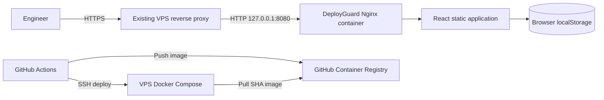

# Architecture

## System context

## Application structure

- `src/domain`: data types, default checklist, and pure readiness calculations.
- `src/lib`: versioned browser persistence and validation.
- `src/components`: accessible UI components.
- `src/App.tsx`: application state and use-case orchestration.
- `deploy`: production web-server configuration.

The domain remains independent of React and browser storage. This keeps business rules easy to test and allows a future API-backed repository to replace local persistence without changing readiness calculations.

## Key decisions

### Static local-first application

The MVP has no server-side data. This minimizes operating cost and removes authentication and database risks while still solving the individual release-checking workflow. The tradeoff is that records cannot be shared or audited centrally.

### Versioned persistence

Stored data uses an explicit schema version. Parsing and validation occur at the storage boundary so malformed browser data cannot break rendering. Future schema changes should add migrations rather than silently changing the stored shape.

### Immutable production releases

CI publishes both `latest` and a commit-SHA tag, but deployment uses the registry digest returned by the build. A release is therefore content-addressed and can be traced or rolled back without guessing which build a mutable tag currently references.

### Reverse proxy remains outside the stack

The container binds to VPS loopback by default. TLS termination and public routing belong to the operator's existing Caddy, Traefik, or Nginx installation. This avoids taking ownership of unrelated domains or certificates.

## Security boundaries

- The application contains no secrets and calls no external APIs.
- The runtime container is non-root, read-only, capability-free, and resource-limited.
- Browser data is untrusted and validated when loaded.
- Deployment secrets are scoped to GitHub's `production` environment.
- SSH host keys are supplied explicitly; the workflow does not trust `ssh-keyscan` at deploy time.

## Evolution path

For shared team state, add an API behind the same reverse proxy and define a repository interface in the frontend. Introduce authentication, authorization, a relational database, server-side validation, audit events, backups, and API contract tests as one coordinated change. Do not expose local records to a new backend without an explicit import and consent flow.
